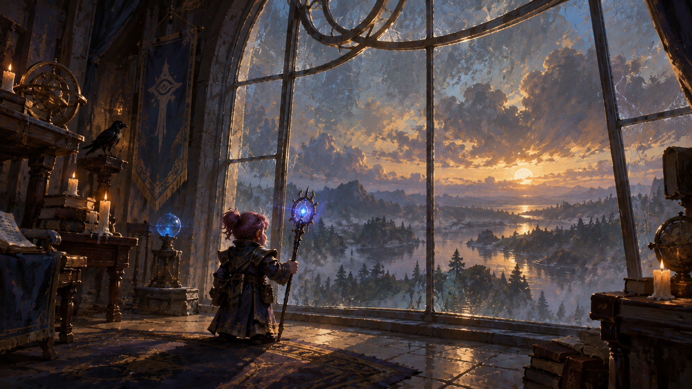

<p align="center">
  
</p>

# Omarchy Gnome Mage Theme

An Omarchy theme for arcane study at dusk. Arcane blue and a spark of pink glow in a candlelit tower above a darkening valley.

This is a dark theme.

## Install

```sh
omarchy-theme-install https://github.com/csfh/omarchy-gnome-mage-theme
```

You can also install it from the Omarchy menu with `Super + Alt + Space`, then `Install > Style > Theme`, using this repository URL:

```text
https://github.com/csfh/omarchy-gnome-mage-theme
```

## Palette

| Role | Hex |
| --- | --- |
| Background | `#100c0d` |
| Foreground | `#ffffff` |
| Accent | `#3a55b8` |
| Red | `#8a3a4a` |
| Green | `#5a7a50` |
| Yellow | `#b08a3a` |
| Blue | `#3a55b8` |
| Magenta | `#a04a8a` |
| Cyan | `#3a8aa8` |

## Included

A `colors.toml` palette, an icon theme (`Yaru-purple-dark`) and a wallpaper. Omarchy builds the terminal, editor, launcher, notification, bar, lock screen, browser and TUI themes from this palette, so `colors.toml` is the single source of truth.

## Backgrounds

The wallpaper:

- [`gnome-mage`](backgrounds/gnome-mage.png)

## License

MIT. See [LICENSE](LICENSE). Copyright (c) 2026 Christoffer Hallas.

If you send a pull request or other contribution, you agree to the [CLA](CLA.md).
